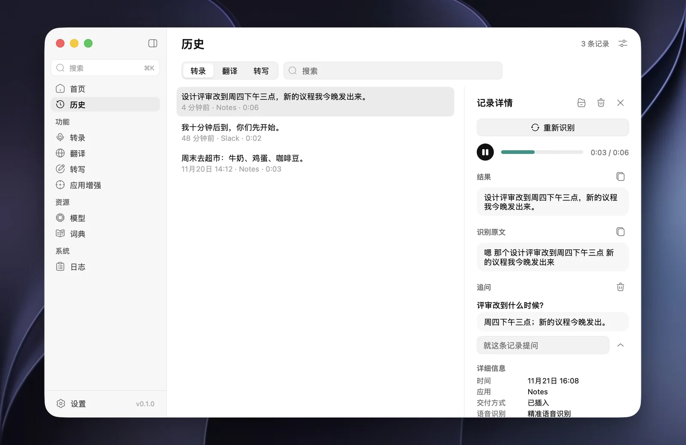
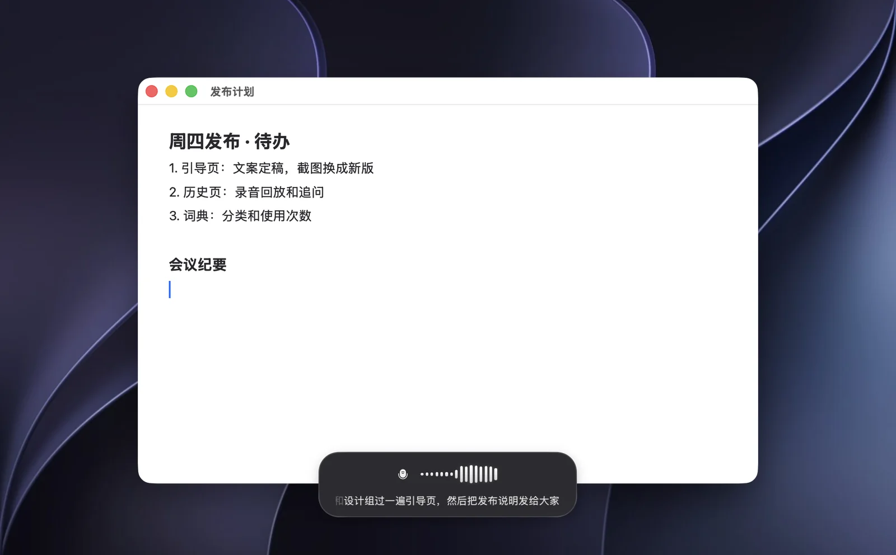
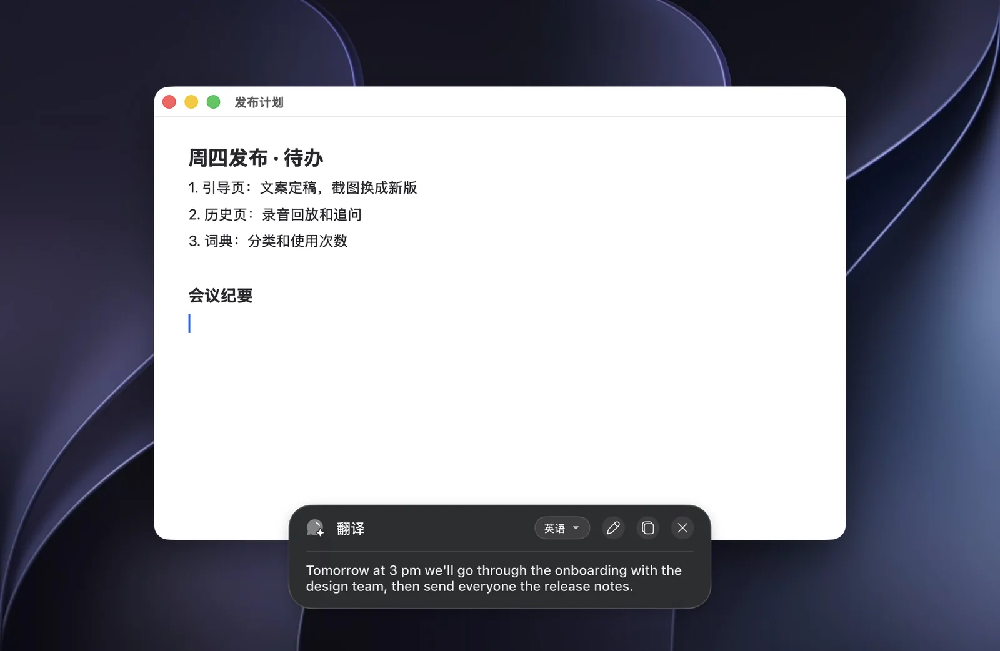
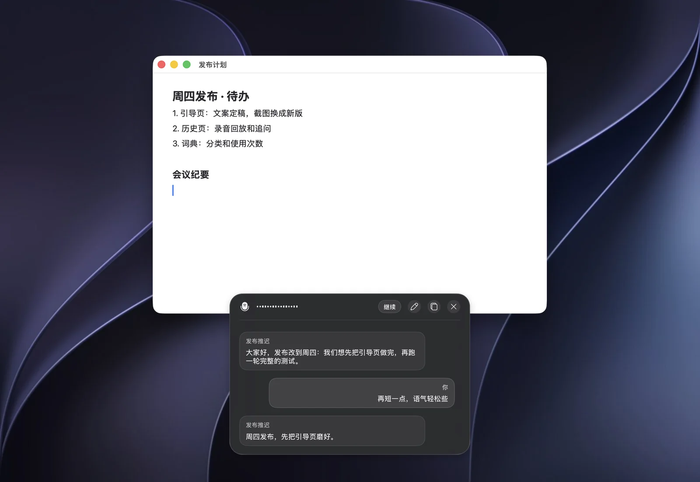
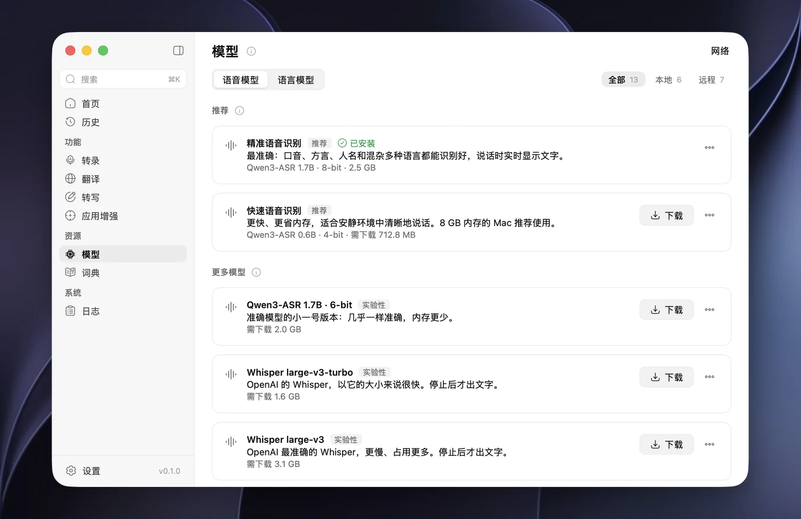
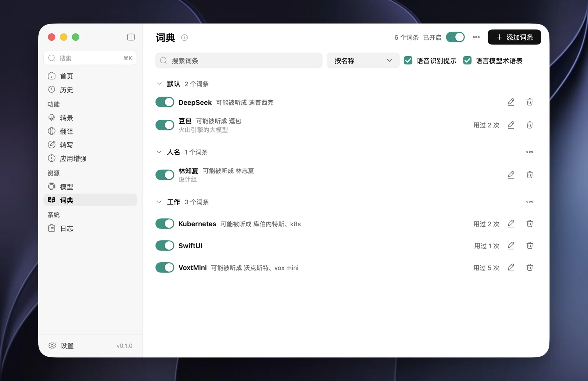

# VoxtMini

以本地模型为主的 macOS 语音输入：在任意 App 里按下快捷键说话，文字出现在光标处。

[English](./README.md) · **简体中文** · [反馈问题][github-issues-link]

[![][website-shield]][website-link]
[![][github-release-shield]][github-release-link]
[![][macos-version-shield]][macos-version-link]
[![][license-shield]][license-link]
[![][release-date-shield]][release-date-link]

> [!NOTE]
> VoxtMini 是 Voxt 的继任者，就在这个仓库里：用 Go 重写，保留 Voxt 的行为，设置更少。Voxt 以 [SGLang Omni Voxt](https://github.com/sgl-project/sglang-omni/tree/main/Voxt) 的形式继续开发；它在本仓库的历史到标签 `voxt-final` 为止。

## ✨ 出口成文

**转录，语音转文本**

- 边说边显示文字，可以再由语言模型整理（去掉口头语，补上标点）
- 可以设一个结束词（“over”“完毕”“以上”），说完就停止录音

  

**翻译，译成英文、中文或日文**

- 翻译说的话，或者选中文字按快捷键翻译

  

**转写，说出你要什么**

- 选中文字，说一句怎么改（“短一点”“正式一点”），或者让它写新内容
- 在答案卡片里继续追问（按空格开始）

  

**应用增强**：把 App 和网站分组，每组有自己的提示词和插入后的按键（聊天时口语一些，插入后按回车发送）。

**词典**：人名和术语听得准、照你的写法输出；支持分类、使用次数、按分组生效。

**历史**：每条结果连同录音（可选）：播放、重试、继续提问。

  
  

中文结果一律是简体字；日文不做任何改动。

[![][back-to-top]](#readme-top)

## 🧠 模型

- **本地**（默认）：语音识别用 Qwen3-ASR 和 Whisper，语言模型用 Qwen3.5、Hy-MT2 等，跑在 MLX 上。需要时才下载，与其他 [ActNow](https://actnow.dev) app 共用。
- **Apple**：Apple 语音识别和 Apple 智能（macOS 26），只在本机运行。
- **远程**（只在你为某个功能选了时才用）：OpenAI、Gemini、Anthropic、DeepSeek、豆包、阿里云百炼等，或者本机的 Ollama / LM Studio。

详见 [VoxtMini 如何工作](docs/how-it-works.md)。

[![][back-to-top]](#readme-top)

## 📦 下载 / 安装

- [官网](https://actnow.dev/voxtmini)
- [从官网下载](https://actnow.dev/download/voxtmini)
- [GitHub Releases](https://github.com/hehehai/VoxtMini/releases)（标签 `v0.x`；`v1.x` 是 Voxt 的版本）

需要 Apple 芯片、macOS 15 及以上的 Mac；跑推荐的模型，16 GB 内存比较从容。VoxtMini 还在 beta 阶段：见 [CHANGELOG.md](CHANGELOG.md)。

**默认快捷键**：单按右 Option 转录，右 Option + Shift 翻译，Control + 右 Option 转写。

[![][back-to-top]](#readme-top)

## 🔒 隐私

除非你为某个功能选了远程服务，音频和文字都留在这台 Mac 上；选了时，也只有这个功能的数据发给那个服务。密钥保存在钥匙串里。不需要账号，VoxtMini 没有自己的服务器，也不做统计。反馈只在你从反馈窗口（**帮助 → 发送反馈**）提交时发往 actnow.dev（[隐私政策](https://actnow.dev/legal/privacy)）；提交前可以查看诊断信息和错误报告，其中不含你说的话和写的文字。也可以在 GitHub 提公开 issue。

[![][back-to-top]](#readme-top)

## 🛠 开发

[参与贡献](CONTRIBUTING.md#参与贡献) · [文档](docs/README.md) · [架构](docs/architecture.md) · [构建](docs/development.md)

## 许可

Apache 2.0，见 [LICENSE](LICENSE) 和 [NOTICE](NOTICE)。

<!-- LINK GROUP: the releases page, not /releases/latest, which is Voxt's v1.15.0 until a VoxtMini release is marked latest. -->

[back-to-top]: https://img.shields.io/badge/-BACK_TO_TOP-151515?style=flat-square
[website-link]: https://actnow.dev/zh/voxtmini
[website-shield]: https://img.shields.io/badge/website-actnow.dev%2Fvoxtmini-0d9384?style=flat-square&labelColor=000000
[github-issues-link]: https://github.com/hehehai/VoxtMini/issues/new/choose
[github-release-link]: https://github.com/hehehai/VoxtMini/releases
[macos-version-link]: https://github.com/hehehai/VoxtMini/releases
[license-link]: ./LICENSE
[release-date-link]: https://github.com/hehehai/VoxtMini/releases
[github-release-shield]: https://img.shields.io/github/v/release/hehehai/VoxtMini?include_prereleases&filter=v0.*&label=release&labelColor=000000&color=3fb950&style=flat-square&logo=github&logoColor=white
[macos-version-shield]: https://img.shields.io/badge/macOS-15.0%2B-58a6ff?style=flat-square&labelColor=000000&logo=apple&logoColor=white
[license-shield]: https://img.shields.io/badge/License-Apache%202.0-58a6ff.svg?style=flat-square&labelColor=000000&logo=apache&logoColor=white
[release-date-shield]: https://img.shields.io/github/release-date-pre/hehehai/VoxtMini?style=flat-square&labelColor=000000&color=58a6ff&logo=github&logoColor=white
